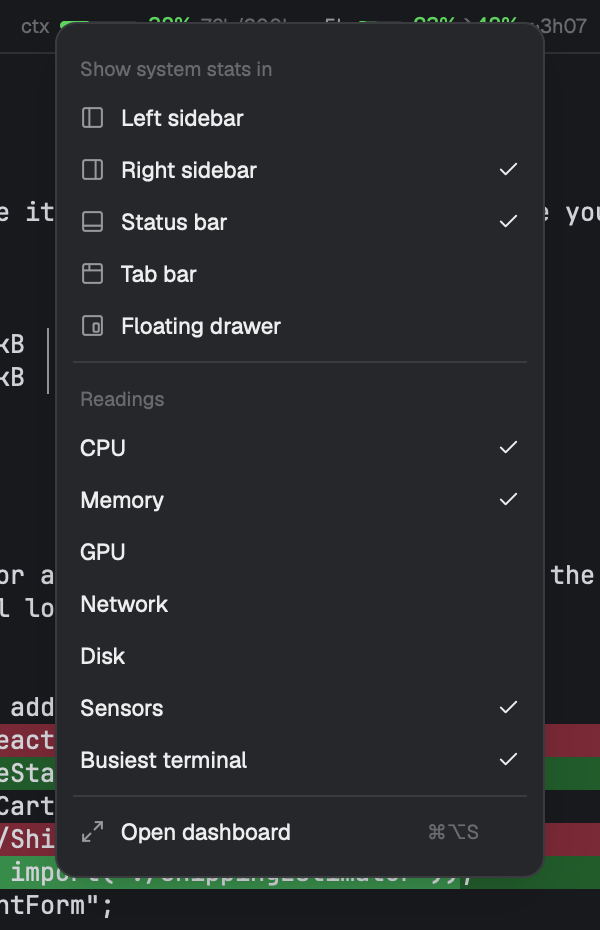

# herdr-stats

[](https://github.com/jeffarese/herdr-stats-mod/actions/workflows/ci.yml)

A mod for the [Herdr](https://herdr.dev) desktop app: this machine's CPU, memory, GPU, network,
disk and temperatures, drawn natively beside your terminals, and **which agent is using them**.

![The Herdr window with the stats as the middle panel of the right sidebar, titled System · sams-macbook: the CPU with its history chart across the panel and a row of cells for the performance and efficiency cores, memory as a split bar of app, wired, compressed and free with its history below, the sensors from the CPU, SoC and SSD to the battery and the fastest fan, and the terminals by CPU, with Claude Code in shop › 1 first. The status bar ends with a line of the CPU chart and figure, memory and temperature. Around them: the Sessions sidebar on the left with the spaces of two machines, Local and studio; Claude Code speeding up the checkout page in the middle, under a header with its model, context and limits; the pull requests above the stats; and what's running below them, mostly under two notifications in the bottom right corner. Everything but the stats panel and the status bar is dimmed. The sessions are made up; the readings are the Mac's own.](preview.png)

*Around it: the [Sessions sidebar](https://github.com/jeffarese/herdr-agents-sidebar) on the left, a pane header with the model and limits, [pull requests](https://github.com/jeffarese/herdr-prs) above the stats on the right with what's running below, and two notifications in the corner. Every session in it is made up.*

Agents compile, test and index all day. When the fans spin up, the question isn't "how busy is
the machine" but "**which of my terminals is it?**" herdr-stats answers that from Herdr itself:
it knows which processes belong to which terminal, so CPU and memory roll up to
*Claude Code · shop › 1* rather than to a PID. Click it and you're there.

This is an unofficial mod. It is not affiliated with Herdr.

## Highlights

- **Wherever it fits.** The left sidebar, a right sidebar, the status bar, the tab bar, or a
  drawer on the window's edge, picked from a menu inside the mod, several at once if you like.
  It measures the room it's given and draws to fit: charts in a sidebar, a line of figures in a
  bar, a column of numbers when the sidebar is folded.
- **Shape, not just numbers.** A history behind every reading; one cell per core, split into
  performance and efficiency cores; memory as app, wired and compressed. 70% and rising and
  70% and falling are different machines.
- **Per terminal, per agent.** Every terminal ranked by CPU, with its space and tab, its memory
  and its process count. ↑↓ and ⏎ jump to it.
- **Temperatures without sudo.** CPU, GPU, SoC, SSD and battery from Apple's SMC and HID
  sensors, and the fans.
- **Cheap enough to forget.** One small sampler serves every copy: about 0.3% of one core and
  8 MB. Copies redraw only when a number changed, and at most every 5 s while Herdr is in the
  background.

## Install

Ask your agent, in a terminal inside Herdr:

> Add the Herdr mod at github.com/jeffarese/herdr-stats-mod

Or run the installer:

```sh
curl -fsSL https://raw.githubusercontent.com/jeffarese/herdr-stats-mod/main/install.sh | sh
```

It copies `mods/herdr-stats` into `~/.config/herdr-app/mods`, checks it with `herdr-app check`,
binds **⌥⌘S** to the dashboard (unless that key is already yours), and opens the dashboard.
Click **Show in…** there to keep the stats on screen. Run it again to update.

It needs the Herdr app (tested with 0.1.16) on an Apple Silicon Mac or on Linux, and `python3`
for the installer. From a clone, `./install.sh` does the same.

## Where it shows

The stats start hidden. **Show in…** (the button in the dashboard, or the `⋯` on any copy)
lists the places your layout has room for. Each is a switch, and the same menu picks the
readings, shared by every place.

<p align="center"></p>

| Place | What you get |
| --- | --- |
| **Left sidebar** | A panel under Herdr's lists: a line per reading with its chart, then the busiest terminal. Folded narrow, it becomes a column of figures. |
| **Right sidebar** | Joins the right sidebar, a `sidebar-right` column every panel there shares (a PR list, say), under what's already in it; with nothing there it starts one. Folding the sidebar to a rail folds every panel in it, so the stats show their rail too. With that much height it shows the dashboard's sections, one under another. |
| **Status bar** | One line at the right end of the status bar. What doesn't fit is left out from the end of your list. |
| **Tab bar** | The same line at the end of the tab bar. |
| **Floating drawer** | Figures peek from the window's edge; hover and the charts slide out. Drag it to any edge. |

![The Herdr window with the stats in four other places at once: a panel at the bottom of the left sidebar with CPU, its history and core cells, memory, the CPU, SoC, SSD and battery temperatures, and Claude Code in shop › 1 as the busiest terminal; the tab bar, shown above the pane, ending with a line of CPU, memory and temperature; the same line at the end of the status bar; and a drawer peeking from the right edge, over the pull requests, with the CPU, memory and temperature figures stacked. The Sessions sidebar, the agent's screen, the pull requests and what's running fill the rest, with two notifications in the corner. The sessions are made up.](docs/media/places.png)

Herdr's own layouts are read-only, so on one of them your first pick makes a personal copy
(`main-stats`) and switches to it; the menu says so before you click.

## The dashboard

**⌥⌘S**, or click any reading.

![The dashboard over the Herdr window, titled System, sams-macbook, with its uptime, live. On the left: the CPU with its history and a cell for every performance and efficiency core, memory broken into app, wired, compressed, free and swap, GPU, network in and out, the disk, and the sensors from the CPU to the fastest fan. On the right: the terminals by CPU, Claude Code in shop › 1 first, then the other agents, servers and shells of the made-up spaces, and below them the busiest processes. Behind it: the Sessions sidebar, the agent's screen, the pull requests, the stats in the right sidebar and two notifications. The sessions are made up.](docs/media/dashboard.png)

On the left, each reading with room to read it. On the right, every terminal on this computer
by CPU, with its space and tab, and your busiest processes. `↑` `↓` and `⏎` (or a click) go to a
terminal; a sub-agent without a pane opens as a peek. `esc` closes it.

## How it works

A mod can't read the hardware, so it starts a small sampler, `bin/herdr-stats-sampler` (Rust,
about 500 KB), through Herdr's `exec`. Once a second the sampler writes a snapshot of a few KB to
`~/Library/Caches/herdr-stats/snapshot.json`, and every copy of the mod reads that file.

- **One sampler.** It holds a lock, so a second start exits at once.
- **No orphans.** Each copy checks in by touching a file every 10 s. The sampler exits 30 s
  after the last check-in, when Herdr quits, and in any case after 9 minutes (Herdr caps an
  `exec` at 10); the next one picks the charts up from the last snapshot. Switching layouts
  doesn't interrupt it.
- **Detail on request.** Per-terminal use is sampled every 2 s from the process tree under each
  terminal's shell, which herdr-core reports. The machine-wide process list is gathered only
  while the dashboard is open.

On Linux without the binary, the mod reads `/proc` itself: CPU, memory, network, disk and load,
with no GPU, temperatures or per-terminal use.

### What the numbers mean

- **CPU** is the share of all cores, like Activity Monitor's CPU history. Per terminal and per
  process it's in cores, like `top`: 200% is two cores busy.
- **Memory used** is app + wired + compressed, as Activity Monitor counts it. Pressure turns the
  reading amber and red even when "used" looks fine.
- **Disk** is how full the startup disk is: everything not available, as Finder and About This
  Mac count it. On macOS that includes the system volume, swap and snapshots that share the disk
  with your files, so it reads higher than `df` on `/System/Volumes/Data`.
- **Temperatures** turn amber at 85° and red at 97°. Apple Silicon has no separate memory
  sensor: memory sits in the chip package, so SoC is the closest reading.

## Privacy and what it touches

- **Names, never command lines.** Only process names are read: an agent's argv can hold an API
  key.
- **Runs programs:** its own `bin/herdr-stats-sampler`, `touch` (checking in, and asking for the
  process list while the dashboard is open), and `df` on Linux. It never signals a process. The
  sampler runs `hc ls` and `hc get` to map terminals to their shells.
- **Reads files outside its folder:** its snapshot, Herdr's `installed.json` (to know Herdr's own
  layouts), and on Linux `/proc`.
- **Writes files outside its folder:** only the sampler's `~/Library/Caches/herdr-stats/`
  (`~/.cache/herdr-stats/` on Linux). The mod changes your layout only when you pick a place in
  **Show in…**.
- **No network.**

## Remove

```sh
curl -fsSL https://raw.githubusercontent.com/jeffarese/herdr-stats-mod/main/install.sh | sh -s -- --remove
```

It takes the stats out of every personal layout (keeping the old file as
`<layout>.json.before-stats`), removes the ⌥⌘S binding if it's still the mod's, stops the
sampler and deletes the mod and its cache.

## Troubleshooting

- **Nothing shows after installing.** The stats start hidden: press ⌥⌘S and use **Show in…**.
- **"paused" in the header.** The snapshot is more than a few seconds old. The mod starts a new
  sampler by itself within 5 s; if the panel says the sampler didn't start, hover it for the
  reason.
- **A terminal shows 0% while busy.** Per-terminal use comes from herdr-core's view of each
  terminal's shell; programs started outside a Herdr terminal count only in the process list.
- **⌥⌘S does nothing.** The installer leaves a key that's already bound alone and says so. Bind
  another in `~/.config/herdr-app/keys.json`: `"global": { "<key>": "mod.open:herdr-stats" }`.

## Develop

```sh
npm test                    # the mod: views, placement, feed, installer (node, no Herdr needed)
npm run test:sampler        # the sampler's own tests (cargo)
scripts/build-sampler.sh    # release build, copied into mods/herdr-stats/bin
sh docs/demo/showcase-shots.sh <stage>   # take the README's pictures again (docs/demo/README.md)
```

The mod is plain ES modules against Herdr's `gpui-kit` and `herdr` APIs; the tests run the
real views and handlers against a recording stub of both. [RECIPE.md](RECIPE.md) describes
every view to the pixel, for whoever rebuilds or adapts it. [docs/demo](docs/demo) explains how
the pictures are made without anything personal in them. Changes are in
[CHANGELOG.md](CHANGELOG.md).

The sensor code grew out of [herdr-stats](https://github.com/jeffarese/herdr-stats), the plugin
for the herdr terminal multiplexer.

## Works well with

The pictures above are one Herdr window with these mods running together:

- [Sessions sidebar](https://github.com/jeffarese/herdr-agents-sidebar): every agent and shell on all your machines in one sidebar, with sub-agents and background work.
- [Pull requests](https://github.com/jeffarese/herdr-prs): your pull requests and the state of their checks, in a sidebar.
- [Quick switcher](https://github.com/jeffarese/herdr-bar-mod): ⌘K to any agent, tab, pane or space on every machine.
- [Mod hub](https://github.com/jeffarese/herdr-mod-hub): browse the gallery, read a mod's code before installing it, and manage your mods.
- [Outside](https://github.com/jeffarese/herdr-outside): the agents and terminals herdr-core runs outside your spaces.

## License

[MIT](LICENSE)
