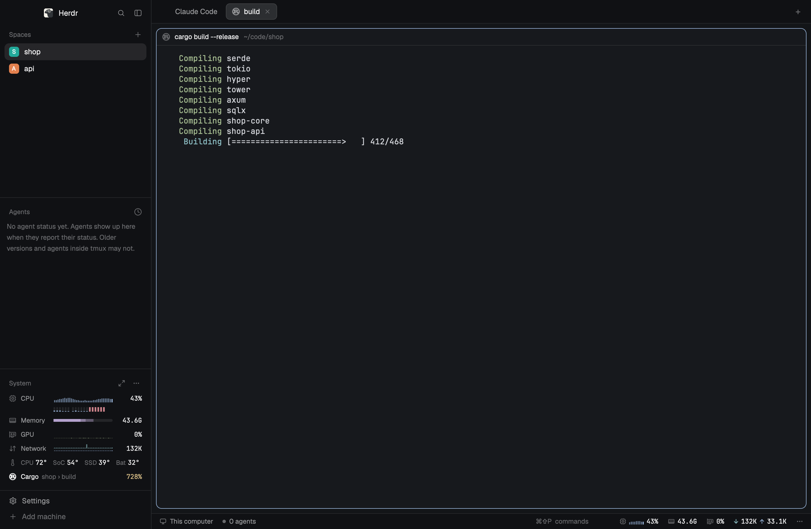

# herdr-stats

This machine's CPU, memory, GPU, network, disk and sensors, and which terminal is using them,
in whichever part of the window the person picks: a sidebar panel of small charts, a line in
the status bar or tab bar, a drawer on the window's edge, or a dashboard dialog.

## What you see

Every color comes from `theme()`. Readings have a hue each at rest (CPU `ansi4`, memory `ansi5`,
GPU `ansi2`, disk `ansi6`, network in `ansi6` and out `ansi4`) and turn `ansi3` (amber) or
`ansi1` (red) past their thresholds: CPU 70/90%, memory 80/92% or pressure 50/75%, GPU 75/92%,
disk 85/95%, temperature 85/97 °C. Values are in the terminal font (`settings().font_family`)
so they don't jitter; labels in the UI font. Chart tracks are `foreground` at 9% opacity.

- **Panel** (a sidebar block, `chrome` background, `border` line on top): a header like Herdr's
  lists (px 16, 41 tall, "System" 11.5 px medium `dim`; on the right two 20 px icon buttons:
  expand → dashboard, `⋯` → menu). Then one 22 px line per reading, 3 px apart, px 16: a 13 px
  `dim` icon, a 50 px label (11.5 px `muted`, hidden under 236 px wide), a chart taking the rest,
  and a 44 px right-aligned value. CPU: bars 2 px wide, 1 px apart, 14 tall, newest on the right
  and full color, older ones at 62%; under it an 11 px row of core cells (8 tall, 2 apart, 5 at
  the efficiency cluster) aligned with the chart. Memory: a 5 px stacked bar (app, wired at 70%,
  compressed at 42%), value used memory ("42.4G"). GPU: like CPU. Network: download above a
  centre line and upload below it on one scale, value the larger rate. Disk: a 5 px bar, value
  percent used. Sensors: no label or value column; after the icon each sensor as a 11 px `dim` name and
  its value in its own severity color ("CPU 82°  GPU 61°  SoC 56°  SSD 38°  Bat 37°", then a
  fan icon and "3.0k" while a fan spins), 10 px apart, as many as fit; the tooltip lists all. Busiest terminal: the program's icon, its name, "space › tab" in `dim`, its
  CPU. Lines that don't fit the height are left out from the end; the core row goes first.
- **Rail** (under 150 px wide) shows a 13 px metric icon above each 10.5 px figure, with a 22×3 bar for readings that have a fraction. Hover for details.
- **Strip** (status bar or tab bar, or under 64 px tall): right-aligned chips, 20 px tall, icon
  plus value (CPU also a 26×11 sparkline), 9 px apart, then a `⋯`. In the status bar it has the
  same `chrome` background and top `border` as Herdr's status line.
- **Drawer** (floating): per reading a 32 px row: a 46 px chip (value over a 9 px label) on the
  edge side, and a 132 px chart beside it that shows when the drawer slides out.
- **Dashboard** (dialog 860 × 84%): a 56 px header (activity icon, "System" 15 px semibold,
  "host · up 13d 6h · live" `dim`, a **Show in…** button, filled with `solid` when the stats are
  placed nowhere yet, and a close button). Two columns under 22 px padding: CPU (64 px history
  with a gridline at 50%, 22 px core cells labelled performance / efficiency), Memory (8 px
  stacked bar, legend, 28 px history), GPU, Network (44 px in/out chart, peak), Disk, Sensors
  (chips); and on the right Terminals (30 px rows: icon, name, "space › tab", title, CPU,
  memory, process count; under 380 px wide only CPU, the rest in the tooltip) and Busiest
  processes. Below 760 px wide it is one column. A 34 px
  footer: "↑↓ choose · ⏎ go to it · esc close".
- **Menu** (popup 270 × 486, `popover`): "Show system stats in" with five 29 px switches (Left
  sidebar, Right sidebar, Status bar, Tab bar, Floating drawer), a check on the ones in this
  layout, unavailable ones `dim` with a tooltip; a note when the layout is Herdr's own; then
  "Readings" with seven switches; then Open dashboard with its key.

## How it behaves

- Numbers update once a second. A copy redraws only when the snapshot changed, and while the
  window is not active a sidebar, bar or drawer redraws at most every 5 s. Nothing animates
  except the dot pulsing while the first reading arrives (`.loop("opacity")`).
- A snapshot older than 3.5 s dims the readings to 55% and the header says "paused".
- Clicking a reading opens the dashboard (`mod.open`). Clicking the busiest terminal, or a row
  in the dashboard, runs `pane.focus {terminal}`, or `terminal.peek` for a sub-agent without a
  pane, and closes the dashboard. In the dashboard ↑/↓ (or j/k) move the selection and ⏎ goes.
- Agent status does not change the stats; terminals are named from `agents()`, `panes()` and
  `terminals()` (program name, "space › tab", the title without its status glyph).
- **Show in…** edits the shown layout with `layout.set`: the left spot inserts a block above the
  sidebar's footer; right joins the right sidebar, a column the layout owns and every panel
  there shares (`sidebar-right`, or any column already at the right edge): at its foot, or, when
  a panel is alone at the edge, in a new `sidebar-right` holding both at the panel's width, or,
  with nothing there, in a new `sidebar-right` of its own; status and tabs wrap that bar in a row
  with the stats at its end; float adds a `floating` entry (right edge, end, peek 58). Taking a
  spot out restores the layout exactly, unwrapping what it wrapped, except that a right sidebar
  stays while another panel is in it (it goes with its last one). `stats-wrap-right`, what older
  versions wrapped a right-edge panel in, is still taken apart. On one of Herdr's own layouts (from
  `installed.json`) the first pick runs `layout.clone {as: "<name>-stats"}` first. Readings live
  in `shared("herdr-stats.metrics")`; changing them resizes a sidebar panel to fit.

## Built from

- `mods/herdr-stats/mod.json`: `{ "place": "none", "title": "System", "overlay": { "kind":
  "dialog", "width": 860, "height": 0.84 } }`. Blocks carry `props.spot`; overlays
  `props.view` ("menu"), or none for the dashboard.
- `main.js` (the View: picks panel, rail, strip, drawer, column or dashboard from `props()`,
  `placement()` and its size from `on_size_change` divided by `settings().zoom`), `views.js`,
  `charts.js` (sparklines, mirrored in/out chart, bars, stacked bar, core cells: all plain divs),
  `model.js` (snapshot → readings, terminal rows, `/proc` parsing), `placement.js` (layout tree
  edits), `feed.js` (the sampler's lifecycle), `format.js`; 19 Lucide-style icons.
- `bin/herdr-stats-sampler` (Rust): `--dir <cache> --interval 1000 --lifetime 540000 --idle 30000`. Writes
  `snapshot.json` atomically each second: cpu (total, busiest, P/E, per core), mem, disk, gpu
  (IOAccelerator `Device Utilization %`), net (`en*` byte counters), temp (SMC core diodes, HID
  sensors), fans (SMC), 180-sample histories, `terms` (per terminal: CPU in cores, RSS, process
  count, busiest process name, from `hc ls` and `hc get` pids every 10 s and a process-tree walk
  every 2 s) and `top` (only while `want-detail` was touched in the last 15 s). Holds an `flock`
  on `sampler.lock`; exits on SIGTERM, when its parent or grandparent exits, when `alive` hasn't
  been touched for `--idle`, or at the lifetime; the next one resumes the histories from the
  last snapshot when it is under a minute old. Every copy calls `feed.checkIn()` each tick,
  which touches `alive` at most every 10 s between them.
- `herdr` calls: `exec`, `readTextFile`, `layout`, `layouts`, `shared`, `setShared`, `run`
  (`layout.set`, `layout.clone`, `layout.resize`, `mod.open`, `pane.focus`, `terminal.peek`),
  `openOverlay`, `closeOverlay`, `panes`, `agents`, `spaces`, `terminals`, `keys`, `placement`,
  `window`, `theme`, `settings`, `appHome`, `home`.

## Watch out

- `on_size_change` reports zoomed pixels: divide by `settings().zoom` before laying out.
- `exec` is capped at 10 minutes, so the sampler retires itself before that and hands its
  history to the next through the snapshot. Never `exec` the sampler from module scope: start it
  from a copy's `cx.spawn`, and let another copy take over when the file goes stale.
- `close()` gets 250 ms before Herdr cancels it, and a layout switch closes every copy just
  before opening the new ones: don't stop the sampler from `close()`. It stops itself when
  nobody checks in. A start from a copy that then closed may never settle its `exec` promise,
  so a stale file 5 s after the last start means start again (the lock turns extras away).
- Every redraw repaints the whole window: notify only when the snapshot changed, and don't use
  transitions on numbers that change every second.
- The mod's folder name is in `MOD` (`placement.js`) and in asset paths; a renamed copy must
  change both.
- Reading `want-detail` and writing it with `writeTextFile` would put a changing file under
  Herdr's watched home; the sampler's cache folder and `touch` avoid that.
- `hc ls --json` has no pids; `hc get <t> --json` does (`pid` is the shell's).
- `proc_pidinfo`'s `pti_total_user`/`pti_total_system` are Mach ticks, not nanoseconds: on
  Apple Silicon multiply by the `mach_timebase_info` ratio (125/3), or per-process CPU reads
  about 42 times too low.
- On APFS, report disk use as size minus available (the container's), not the data volume's
  own used blocks: the system volume, VM and snapshots share the same free space.
- Pictures for a README: `HERDR_STATS_HOST` replaces the host name in the snapshot, and
  `HERDR_STATS_TOP_UNDER=<folder>` limits the process list to programs under that folder.
- Herdr's macOS build is Apple Silicon only, and so is the committed binary. Linux reads `/proc`
  in the mod: no GPU, temperatures or per-terminal use there.

## Done when

- `herdr-app check mods/herdr-stats` passes, and `npm test` passes.
- ⌥⌘S opens the dashboard; within two seconds it shows CPU, memory, the cores split into
  performance and efficiency, and the terminals of this computer sorted by CPU.
- Show in… → Left sidebar puts the panel under the lists; dragging the sidebar narrower drops
  the labels, then turns it into the rail; Show in… → Left sidebar again restores the layout.
- Show in… → Status bar adds a line at the right end of the status bar.
- A busy terminal (`yes > /dev/null` in one) tops the dashboard's list and the panel's busiest
  line within 4 s; clicking it focuses that pane.
- Switching layouts keeps the same sampler (its pid in `snapshot.json` doesn't change).
- Closing every copy stops `herdr-stats-sampler` within 30 s (no process left in `ps`).
